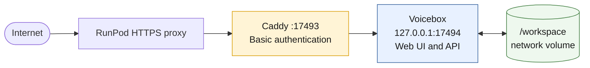
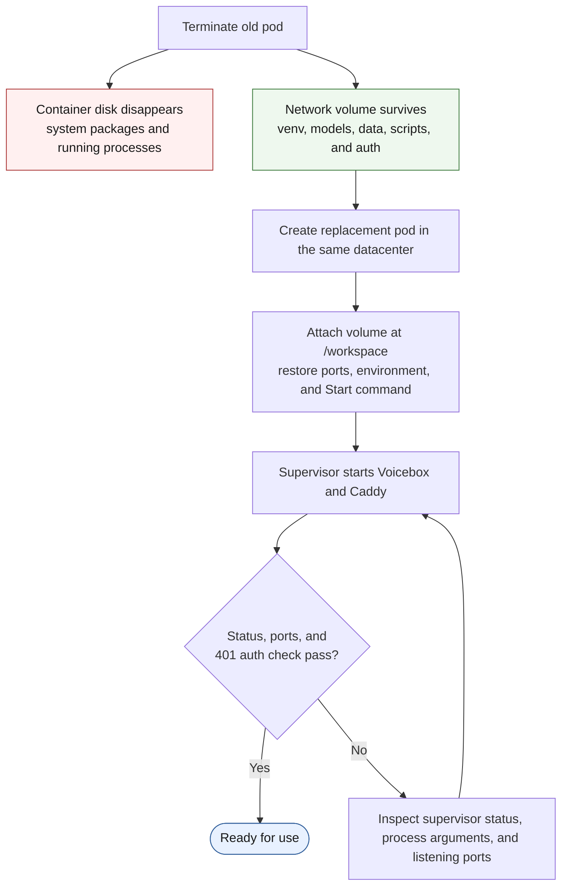

# Deploying Voicebox on RunPod

Voicebox is easy to start locally. Turning it into a dependable GPU service is a different problem: model downloads are large, pods are disposable, the web interface and API need to agree on an origin, and the backend has no built-in authentication.

This is the shorter version of the deployment we built and verified: stock [Voicebox](https://github.com/jamiepine/voicebox), a persistent RunPod network volume, one public port, a password gate, and services that return automatically after a pod restart.

## The target architecture

| Component | Deployment |
|---|---|
| Voicebox backend | FastAPI on private `127.0.0.1:17494` |
| Web interface | Production build served by the backend |
| Public gateway | Caddy on `:17493` with HTTP Basic auth |
| Process management | Supervisor running Voicebox and Caddy |
| Persistent storage | RunPod network volume mounted at `/workspace` |
| Default model | Qwen3-TTS 12Hz 1.7B |



The important boundary is between Caddy and Voicebox. Only Caddy owns the exposed port. Voicebox listens on localhost, so it cannot be reached directly from outside the container.

## Start with persistence

Create the network volume **before** creating the pod. RunPod only lets you attach one at pod-creation time, and a volume is permanently tied to its datacenter. Check suitable GPU availability in that region before committing to it.

We recommend starting with about 60GB. The Python environment alone can consume roughly 13GB, the default model several more, and every additional TTS engine brings its own weights. A network volume can be expanded later, but not shrunk.

Mount it at `/workspace` and keep all expensive or irreplaceable state there:

- the Voicebox clone and Python virtual environment;
- Hugging Face and model caches;
- the application database, profiles, and generated audio;
- bootstrap and service-start scripts; and
- Caddy configuration and its password hash.

The pod's container disk should hold only replaceable system tools and packages. Those disappear when a pod is terminated; the network volume survives.

## Create the GPU pod

Our tested base was the RunPod PyTorch 2.8 template using Ubuntu 24.04 and CUDA 12.8.1. We allocated a 20GB container disk, mounted the network volume at `/workspace`, exposed HTTP port `17493`, and exposed TCP port `22` for SSH.

Set the model caches explicitly:

```text
HF_HOME=/workspace/hf
VOICEBOX_MODELS_DIR=/workspace/models
```

A GPU with at least 16GB of VRAM is sufficient. The RTX 2000 Ada worked, but generation was slow enough that a 4090 or A5000 can be better value when available. Compare cost per finished minute of audio, not only hourly GPU price.

Use RunPod's direct SSH host and port when you need SCP or port forwarding:

```bash
ssh root@<POD-IP> -p <TCP-PORT> -i ~/.ssh/runpod_ed25519
```

The `ssh.runpod.io` proxy is useful for basic shell access, but it does not support SCP or SSH tunnels.

## Install Voicebox once

Tools such as `just` and `bun` live on the disposable container disk, so install them through a repeatable bootstrap script stored on the volume. The Voicebox repository and virtual environment belong on `/workspace`:

```bash
cd /workspace
git clone https://github.com/jamiepine/voicebox.git
cd voicebox
just setup
```

The setup creates the backend virtual environment, installs CUDA-enabled PyTorch and the ML stack, and installs the web dependencies. Verify that the virtual environment can actually see the GPU:

```bash
backend/venv/bin/python -c \
  "import torch; print(torch.__version__, torch.cuda.is_available())"
```

The final value must be `True`. If it is `False`, Voicebox is using CPU-only PyTorch and generation will crawl.

## Serve the UI and API from one origin

Running both uvicorn and a Vite development server creates unnecessary ports and cross-origin configuration. Build the frontend once and let the backend serve it:

```bash
cd /workspace/voicebox/web
bun run build
cp -r dist /workspace/voicebox/frontend
```

Voicebox detects the `frontend` directory and mounts it as static assets with an SPA fallback. In a production build, the UI uses `window.location.origin` for API calls. That gives us one URL for the page, API requests, and generation-progress stream—without custom CORS or server URL settings.

Rebuild and copy the directory again after frontend changes.

## Keep both services running

RunPod containers do not have a normal systemd init process. Supervisor is a practical replacement: it starts Voicebox and Caddy, restarts them after failures, and provides one place to inspect their status and logs.

The core supervisor configuration looks like this:

```ini
[program:voicebox]
command=/workspace/voicebox/backend/venv/bin/python -m backend.main --host 127.0.0.1 --port 17494 --data-dir /workspace/data
directory=/workspace/voicebox
autostart=true
autorestart=true
stopasgroup=true
killasgroup=true
stdout_logfile=/workspace/voicebox.log
redirect_stderr=true
environment=HF_HOME="/workspace/hf",VOICEBOX_MODELS_DIR="/workspace/models",HF_HUB_ENABLE_HF_TRANSFER="0"

[program:caddy]
command=/usr/bin/caddy run --config /workspace/caddy/Caddyfile --adapter caddyfile
directory=/workspace/caddy
autostart=true
autorestart=true
stdout_logfile=/workspace/caddy.log
redirect_stderr=true
```

Verify the long `command=` line after writing it. A terminal truncated ours during setup, dropping the correct port and data directory. Voicebox started successfully—but on the wrong port with an empty database, which made the failure surprisingly confusing.

After changing supervisor configuration, a normal program restart is not enough. Reload the configuration first:

```bash
supervisorctl reread
supervisorctl update
supervisorctl status
```

Store a `/workspace/start.sh` script that reinstalls disposable packages when necessary, writes the supervisor configuration, and launches supervisord. To run it automatically, set the pod's Start command override to:

```bash
bash -c "bash /workspace/start.sh & /start.sh"
```

The trailing `/start.sh` is critical: it is RunPod's own startup process, responsible for SSH and public-key setup. Replacing it entirely can lock you out of the pod.

## Put authentication in front of Voicebox

Voicebox's local backend does not authenticate users. Exposing it directly would let anyone who discovers the URL consume GPU time and, once a cloned voice is available, synthesize speech with it.

Caddy provides a small but effective gate. First generate a bcrypt password hash:

```bash
caddy hash-password --plaintext 'CLIENT-PASSWORD'
```

Then store the following Caddyfile on the persistent volume:

```caddyfile
:17493 {
    basic_auth {
        client PASTE_BCRYPT_HASH_HERE
    }
    reverse_proxy 127.0.0.1:17494 {
        flush_interval -1
    }
}
```

`flush_interval -1` prevents proxy buffering from breaking the server-sent event stream used for generation progress. When writing this file from a shell, use a quoted heredoc because bcrypt hashes contain `$` characters that an unquoted shell can silently expand.

The plaintext password never needs to live on the pod. Only the one-way hash is stored. Use Basic auth only through RunPod's HTTPS proxy; the header is encoded, not encrypted, on plain HTTP.

Verify all three boundaries:

```bash
curl -s -o /dev/null -w "%{http_code}\n" localhost:17494/health
curl -s -o /dev/null -w "%{http_code}\n" localhost:17493/health
curl -s -o /dev/null -w "%{http_code}\n" -u client:'PASSWORD' localhost:17493/health
```

The expected results are `200`, `401`, and `200`. Also open the public URL in an incognito window: nothing should render before the browser asks for credentials.

Basic auth is appropriate for a small deployment, but it still means one shared password, no per-user audit trail, and no rate limiting. For ongoing client access, Cloudflare Tunnel plus Access is the stronger design: no exposed inbound port, individual identities, revocation, audit logs, and a stable domain across pod recreation.

## The failures worth remembering

| Symptom | Actual cause | Fix |
|---|---|---|
| `uvicorn` is missing | Voicebox was started with system Python | Use `backend/venv/bin/python` |
| Public port remains “initializing” | Nothing is listening on the exposed port | Confirm Caddy owns `0.0.0.0:17493` |
| Profiles disappear | The supervisor command lost `--data-dir` | Inspect the running process arguments |
| Config edits appear ignored | Supervisor is still using its loaded config | Run `reread` and `update` |
| Logs disagree with reality | Old log output is being mistaken for current state | Trust `ps` and `ss` first |
| FlashAttention compiles with one worker | `ninja` is absent | Install `ninja` and `packaging` before building |

Two commands proved more reliable than log tails during diagnosis:

```bash
ps -p $(supervisorctl pid voicebox) -o args=
ss -tlnp | grep -E "17493|17494"
```

They show what arguments are actually running and which addresses are actually listening.

## Storage and performance

On the RTX 2000 Ada, generating about 6.7 minutes of audio took roughly 13 minutes—a real-time factor near 1.9. FlashAttention may provide a moderate improvement, but it is optional, version-sensitive, and may require a source build. Moving to a faster GPU is often the simpler and more economical optimization.

Storage also needs occasional attention. Pip's cache can consume several gigabytes after installation, and unused model engines are safe to remove because they can be downloaded again:

```bash
rm -rf /workspace/.cache/pip
du -h -d 2 /workspace 2>/dev/null | sort -h | tail -25
```

Voicebox already handles long input by splitting text into chunks, generating them sequentially, and joining them with a short crossfade. Manual text splitting is generally unnecessary.

## Recreating the pod

Once `/workspace` is populated, a replacement pod should be routine:



The pod ID, public URL, IP, and SSH port can change. The virtual environment, models, data, scripts, and authentication configuration do not.

## Takeaway

The GPU was not the difficult part. The durable deployment came from treating the pod as disposable, keeping state on a network volume, serving UI and API from one origin, binding the unauthenticated backend privately, and verifying live processes instead of trusting stale logs.

That turns a one-off demo into a service that can be stopped, restarted, recreated, and safely handed to a client.
